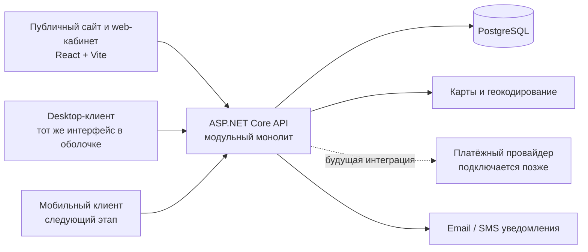

# Архитектура сервиса выгула собак и передержки

**Статус:** рабочий проектный черновик по последним требованиям пользователя. Старый `MVP.md` и документы в репозиториях считаются исходными заметками о текущем прототипе; если они расходятся с этим документом, приоритет у согласованных требований продукта.

## 1. Цель и порядок выпуска

Сначала выпускаем desktop-приложение и веб-сайт с личным кабинетом. Затем подключаем онлайн-оплату. После проверки основных сценариев выпускаем мобильное приложение. Все клиентские приложения работают с одним API и одной базой данных.

Основной сценарий: владелец создаёт заказ на выгул или передержку с описанием собаки, временем и местом; исполнитель находит подходящие открытые заказы на карте и берёт заказ; стороны видят его статус и дальнейшие действия.

## 2. Роли и доступ

### Владелец собаки

- Регистрируется, подтверждает контакт и входит в защищённый аккаунт.
- Создаёт карточки собак.
- Создаёт заказы на выгул и передержку, указывает даты, место, пожелания и описание.
- Видит свои заказы, назначенного исполнителя и отчёт после услуги.
- После подключения платежей оплачивает заказ и видит возвраты/статус платежа.

### Исполнитель

- Заполняет профиль, указывает услуги: выгул, передержка или обе.
- Указывает район работы и доступность.
- На карте ищет открытые заказы, фильтрует их по услуге, времени и району.
- Берёт заказ в работу, отмечает выполнение и оставляет отчёт.
- После подключения платежей видит начисления и выплаты.

### Администратор / поддержка

Управляет жалобами, пользователями, заказами и спорными оплатами. Роль выдаётся только внутренне; публичная регистрация администратора запрещена.

**Рекомендация для модели аккаунта:** один аккаунт должен иметь возможность быть и владельцем, и исполнителем. В интерфейсе можно переключать режим. Сейчас API хранит одну строковую роль `Owner` или `Walker`, поэтому это потребуется заменить профилями/разрешениями, прежде чем появится сценарий совмещения ролей.

## 3. Навигация и вкладки

### Публичный сайт

- **Главная** — что делает сервис и кнопки регистрации/входа.
- **Выгул** и **Передержка** — описание услуг и правила.
- **Исполнителям** — как присоединиться и как получать заказы.
- **Безопасность и FAQ**.
- **Войти / Зарегистрироваться**.
- **Правила сервиса**, **Политика конфиденциальности**, **Контакты** — ссылки в подвале.

### Кабинет владельца (web и desktop)

| Вкладка | Назначение |
| --- | --- |
| **Карта** | Открыть карту, видеть свои заказы и создавать заказ кнопкой «Разместить заказ». |
| **Мои заказы** | Открытые, назначенные, завершённые и отменённые заказы; детали и отчёты. |
| **Мои собаки** | Добавление и редактирование карточек собак. |
| **Сообщения** | Связь с исполнителем; можно включить после основного потока заказов. |
| **Оплата** | Способы оплаты, платежи и возвраты; появляется при подключении провайдера. |
| **Профиль** | Контакты, безопасность, настройки и выход. |

### Кабинет исполнителя (web и desktop)

| Вкладка | Назначение |
| --- | --- |
| **Карта заказов** | Открытые заказы на карте и в списке; фильтры «Выгул», «Передержка», даты и район. |
| **Мои заказы** | Заказы, которые исполнитель принял, выполняет или завершил. |
| **Календарь** | Расписание заказов и доступность исполнителя. |
| **Услуги и районы** | Какие услуги оказывает исполнитель, где и когда доступен. |
| **Выплаты** | Начисления, комиссии и выплаты после подключения оплаты. |
| **Сообщения** | Общение с владельцами. |
| **Профиль** | Описание, контакты, подтверждение профиля и настройки безопасности. |

В desktop-версии основная навигация может быть боковой панелью, на сайте — верхнее меню и те же разделы кабинета. На узком экране меню превращается в компактную навигацию. Мобильный интерфейс позже использует те же названия разделов, но отдельную компоновку.

## 4. Карта и публикация заказов

- Исполнитель видит на карте **открытые заказы** на выгул и передержку, а также список карточек рядом с картой.
- Фильтры: тип услуги, даты/время, район или радиус, продолжительность прогулки и другие согласованные параметры.
- Владелец создаёт заказ из раздела карты или кнопкой «Разместить заказ»; в форме выбирает собаку и услугу, задаёт время/даты, место и описание.
- До назначения исполнителя карта показывает только примерное место или район. Точный адрес и контакты доступны назначенному исполнителю в деталях заказа. Это снижает риск раскрытия домашнего адреса.
- На первом этапе карта показывает место заказа и его статус; непрерывное GPS-отслеживание прогулки не входит в стартовый объём и требует отдельного согласия и правил приватности.
- Адрес вводится текстом и геокодируется в координаты через подключаемого провайдера карт. Провайдера и геокодера выбираем после определения страны/города запуска.

## 5. Жизненный цикл заказа и оплаты

Заказ и платёж — отдельные сущности и отдельные наборы статусов. Это позволит добавить оплату позже, не смешивая её со статусом выполнения услуги.

**Заказ:** `Open` → `Assigned` → `InProgress` → `Completed`; возможны `Cancelled` и отдельный разбор спорных случаев. Назначение открытого заказа исполнителю должно выполняться атомарно: только один исполнитель может успешно его принять.

**Платёж (будущий этап):** `Created` → `RequiresAction` → `Paid/Authorized` → `RefundPending` / `Refunded`; для исполнителя отдельно учитываются `PayoutPending` → `PaidOut`. Точные статусы будут приведены к возможностям выбранного платёжного провайдера.

Интеграция оплаты должна проходить через серверный модуль-посредник: создание платежа, проверка подписанных уведомлений провайдера, защита от повторной обработки уведомлений, журнал операций и возвратов. Приложение не хранит данные банковской карты. До выбора провайдера нужно согласовать страну запуска, комиссию сервиса, порядок выплат исполнителям, отмен и возвратов. Не следует обещать «эскроу» или удержание средств, пока это не подтверждено выбранным провайдером и правилами рынка.

## 6. Техническая схема

- **Сайт и desktop:** текущий React + Vite можно развивать как web-кабинет и переиспользовать UI для desktop. Технологию оболочки (например, Tauri или Electron) выбираем после подтверждения ОС и требований к установке/обновлениям.
- **Мобильное приложение:** отдельный мобильный UI, который использует то же API, правила доступа и модель заказов. Не копировать серверную бизнес-логику в приложение.
- **API:** текущий ASP.NET Core; начать с модульного монолита, а не набора микросервисов. Модули: учётные записи и доступ, профили, собаки, заказы, геопоиск, уведомления, платежи (позже).
- **Данные:** текущая PostgreSQL. Основные сущности: `User`, профили владельца/исполнителя, `Dog`, `Order`, история статусов заказа, координаты/адрес заказа, `Payment` и журнал платежных событий (позже). Фото собаки и документы хранить в объектном хранилище, а в БД сохранять ссылки и метаданные.
- **Интеграции:** провайдер карт/геокодирования, email/SMS и платёжный провайдер подключаются через серверные адаптеры, чтобы не привязывать модели заказа к конкретному поставщику.

## 7. Защищённая регистрация и данные

Минимальные требования перед публичным запуском:

- HTTPS, хеширование паролей современной библиотекой, проверка email и сценарий сброса пароля.
- Нормализация email и уникальное ограничение в базе; ограничение частоты входа и регистрации.
- Сервер сам проверяет права владельца и исполнителя на каждый заказ, собаку, адрес и файл; скрытия вкладки во frontend недостаточно.
- Сессии имеют срок действия, могут быть отозваны при выходе и смене пароля; секреты и ключи интеграций не хранятся в клиентском приложении.
- Для исполнителя предусмотреть отдельное подтверждение контактных данных и, если это требуется правилами запуска, проверку личности.
- Не показывать точный адрес открытого заказа всем посетителям или всем исполнителям до его назначения.

В текущем API уже есть хеширование паролей, bearer-сессии и базовое разделение доступа к владельцам и исполнителям. Перед реальным запуском нужно закрыть недостающие сценарии подтверждения email и сброса пароля, добавить уникальность email на уровне БД и проверить атомарное принятие заказа. Карта, оплата и рабочие экраны пока не реализованы.

## 8. Этапы реализации

1. **Зафиксировать решения:** первая ОС desktop, город/страна запуска, один аккаунт с двумя режимами или отдельные аккаунты, правила показа адреса и цены.
2. **Подготовить основу API:** безопасный вход и восстановление, профили владельца/исполнителя, услуги и районы, надёжные статусы и атомарное назначение заказа.
3. **Собрать web и desktop:** публичные страницы, регистрация, карточки собак, создание заказа, карта заказов, фильтры, личные заказы и статусы.
4. **Подключить оплату:** после выбора рынка и провайдера, включая возвраты и расчёты с исполнителями.
5. **Выпустить мобильный клиент:** переиспользовать API и правила продукта, адаптировать навигацию и карту для телефона.

## 9. Решения, которые ещё нужно принять

- Desktop выпускаем только для Windows или сразу для macOS тоже?
- В каком городе и стране начинается работа? Это влияет на карты, платежи, уведомления и документы.
- Один пользователь сможет одновременно быть владельцем и исполнителем? Рекомендация — да, с переключением режима.
- Исполнитель сам принимает цену заказа или владелец предлагает бюджет/фиксированную цену?
- Платёж списывается при создании заказа или после назначения исполнителя? Как рассчитываются комиссия, отмена и возврат?
- Нужен ли полноценный web-кабинет наравне с desktop или сайт сначала только публичный, а работа в desktop-приложении?

## 10. Референсы: Rover и Wag

По публичным официальным страницам (проверено 24.11.2026): Rover описывает поиск исполнителей с фильтрами, бронирование и безопасную оплату, сообщения, фото и GPS-карты прогулок; для исполнителей — обработку запросов, профиль, баланс, историю и вывод заработка. Wag показывает выгул, присмотр, передержку и визиты, а также выделяет проверку исполнителей, страхование, круглосуточную поддержку и GPS-отслеживание прогулок. Это обзор публичных описаний продукта, а не полный разбор экранов внутри приложений.

Для нашего сервиса из этих примеров стоит взять продуктовые паттерны:

- Единый поток заказа: поиск/карта → подробности → запрос или принятие → статусы → отчёт и оплата.
- Карточки и фильтры рядом с картой: на desktop карта дополняется списком, чтобы заказы можно было сравнить и открыть без точного попадания в маркер.
- Доверие и безопасность как часть профиля исполнителя: подтверждённые контакты, понятная информация об исполнителе, правила безопасности и доступ к поддержке. Проверки личности, страхование и круглосуточную поддержку запускать только после определения рынка и операционной модели.
- Фотоотчёты и сообщения — полезный следующий слой после создания/назначения заказа; GPS-маршрут оставить для мобильного этапа, с явным согласием и настройками приватности.
- Баланс, история платежей и выплаты исполнителю относятся к платёжному этапу, а не должны смешиваться со статусом заказа.

В первой версии сохраняем выбранные услуги **выгул** и **передержка**. Другие категории из референсов (например, визит без прогулки или дневной присмотр) не добавляем автоматически — их можно обсудить отдельно. Официальные страницы: [Rover App](https://www.rover.com/app/) и [Wag! App](https://wagwalking.com/app).
